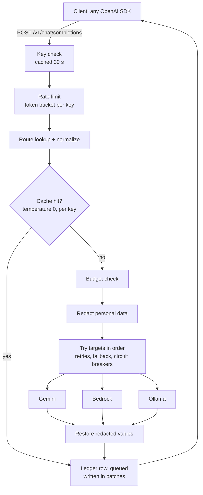

# LLM Gateway

One OpenAI-compatible endpoint in front of several model providers (Gemini, Amazon Bedrock, Ollama). An application sends ordinary OpenAI requests. The gateway decides which provider serves each one and turns provider failures into errors the client can act on.

Any existing OpenAI client works without code changes. Only the base URL changes:

```python
from openai import OpenAI

client = OpenAI(base_url="http://localhost:8000/v1", api_key="gw_...")   # a gateway key
reply = client.chat.completions.create(model="demo", messages=[{"role": "user", "content": "hi"}])
```

## Status

| Day | Scope | State |
|---|---|---|
| 1 | OpenAI-compatible `/v1/chat/completions` and `/v1/models`, adapters for Gemini, Bedrock, Ollama and a fake provider, OpenAI-format errors | done |
| 2 | API keys, Postgres request ledger with cost estimates, per-key monthly budgets, `/v1/usage` | done |
| 3 | Timeouts, retries, fallback across a route's targets, circuit breakers, `/v1/status` | done |
| 4 | Per-key rate limits, response cache | done |
| 5 | Streaming (`stream=true`), redaction of personal data and secrets | done |
| 6 | Load, chaos and cache benchmarks; key cache and batched ledger writes | done |
| 7 | Docker image, Render + Neon deployment, "why not LiteLLM" | done |

## How a request flows



Each check can end the request early with an OpenAI-format error (400, 401, 404, 429, 502, 504).

## Benchmarks

Measured with `python -m bench.run` on a 2-vCPU cloud machine (Intel(R) Xeon(R) Processor @ 2.10GHz), ledger on SQLite, against fake providers so that latency and failures are controlled. Full tables and method: [bench/RESULTS.md](bench/RESULTS.md).

| What | Result |
|---|---|
| Time the gateway adds per request | 1.8 ms at p50 (was 6.0 ms before caching key lookups and batching ledger writes) |
| Throughput, instant provider, 10 concurrent | 784 requests/s (was 192) |
| Added latency, 200 ms provider, 50 concurrent | 3.0 ms at p50, 69.2 ms at p95 (was 27.4 / 252.0 ms) |
| Provider failing 30% of calls | 100.0% of requests succeed with retry + fallback, vs 66.4% with no protection |
| Provider that hangs (1 s timeout) | mean latency 106 ms with the circuit breaker, vs 1056 ms without; 10 of 200 requests waited out the timeout instead of all 200 |
| Repeat questions, temperature 0 | 87.5% cache hits: 125 provider calls for 1000 requests, hits answered in 2.7 ms vs 304.1 ms |

**How the overhead came down.** Timing each part (the same 1,000 requests with the key lookup cached, then with the ledger write removed) showed the gateway's own logic took about 0.6 ms; the rest was two database round trips per request, the API-key lookup and the ledger insert. Valid keys are now cached for 30 s (`KEY_CACHE_TTL_S`) and ledger rows are written by a background task in batches (`LEDGER_BATCHED`). Both are trade-offs, listed under design choices.

## Run it

```bash
python -m venv .venv && source .venv/bin/activate
pip install -e ".[dev]"
cp .env.example .env          # add provider settings; with none, only the fake provider is on
alembic upgrade head          # create the tables (SQLite by default, Postgres via DATABASE_URL)
python -m gateway.keys create --name my-app --budget 5 --rpm 30   # prints the key once
uvicorn gateway.main:app --reload
```

Keys: `python -m gateway.keys list` and `python -m gateway.keys revoke <prefix>`. A key's spend this month, and the circuit breaker state of each provider:

```bash
curl -H "Authorization: Bearer gw_..." localhost:8000/v1/usage
curl -H "Authorization: Bearer gw_..." localhost:8000/v1/status
```

The shipped `resilient` route shows fallback with no API keys. Its first target, `flaky`, fails half its calls, and `fake` catches them. Send it 20 requests: all succeed, `x-gateway-provider` shows who answered, and `/v1/status` shows `flaky`'s circuit open.

`routes.yaml` maps the model names clients send to provider models. Targets are tried in order until one answers:

```yaml
routes:
  fast:
    - provider: gemini
      model: gemini-2.5-flash
    - provider: bedrock
      model: us.amazon.nova-2-lite-v1:0
```

The gateway refuses to start if a route names a provider that isn't configured. A typo shows up at boot, not as an error on the first request.

## When a provider fails

| What went wrong | What the gateway does | Why |
|---|---|---|
| Provider down (5xx, connection refused) | Retry the same target with jittered backoff (2 tries by default), then the next target | Often a blip; a second try is cheap |
| Timeout | Next target immediately | A retry would wait just as long again |
| Provider rate limit (429) | Next target immediately | A retry would be throttled again |
| Gateway's provider credentials rejected | Next target immediately | This target is misconfigured; others may be fine |
| Provider rejects the request (bad input) | Stop and return the error | Another provider would most likely reject it too |

Each target (provider + model) has a **circuit breaker**. After 5 consecutive failures (`BREAKER_THRESHOLD`) its circuit opens, and requests skip it without paying a timeout to rediscover the outage. After 30 s (`BREAKER_COOLDOWN_S`) one request is let through as a probe: if it succeeds the circuit closes, if not it stays open for another cooldown.

Two clocks bound every request. Each provider call gets `REQUEST_TIMEOUT_S`, enforced on the wall clock as well as by the HTTP client: an HTTP read timeout is per chunk, so a provider trickling bytes could otherwise run past it. The whole request, across retries and fallbacks, gets `TOTAL_TIMEOUT_S`.

The client sees one normal response. `x-gateway-provider` says who answered and `x-gateway-attempts` how many provider calls it took; the ledger records the same. If every target fails, the error says what each one returned, with the status of the last.

Limits worth knowing: breaker state lives in each server process, so replicas learn about an outage separately (shared state, such as Redis, would fix that), and a retry after a timeout can't know whether the provider is still generating, and billing, the first answer.

## Rate limits and caching

**Rate limits.** Each key has a requests-per-minute limit (`--rpm` when creating it, otherwise `DEFAULT_RPM`, 60; `0` means none), enforced with a token bucket: a burst of up to `rpm` requests, then one per `60/rpm` seconds. Over the limit is a 429 `rate_limit_exceeded` with `retry-after`, which the OpenAI SDK reads, so a client with retries on waits and carries on without seeing an error. Successful responses carry `x-ratelimit-limit-requests` and `x-ratelimit-remaining-requests`, as OpenAI's do.

**Response cache.** An identical request (same key, route, messages and options) is answered from memory: no provider call, no cost, `x-gateway-cache: hit`, and a ledger row with provider `cache` and cost 0. `/v1/usage` counts the hits.

- Only `temperature: 0` requests are cached. Any other temperature asks for a sample, and replaying one sample would quietly change what the request means; those get `x-gateway-cache: bypass`.
- Entries belong to one API key. Another key never receives the answer, nor learns from a fast response that someone else asked the same thing.
- Standard `Cache-Control` works: `no-cache` skips the lookup but stores the fresh answer, `no-store` does neither.
- Failures are never cached. Entries live for `CACHE_TTL_S` (1 hour), and the least recently used go first past `CACHE_MAX_ENTRIES`.
- Hits are free, so they're served even when a key's budget is spent; rate limits still count them.

Both keep their state in the server process, like the circuit breakers: with several replicas each has its own buckets and cache, so the effective limit is `rpm × replicas`. Redis would make them shared.

## Streaming

`stream=true` works with every provider (Gemini over server-sent events, Ollama's line-by-line JSON, Bedrock's `ConverseStream`) and comes back in OpenAI's chunk format, so `for chunk in client.chat.completions.create(..., stream=True)` just works. `stream_options={"include_usage": true}` adds a final chunk with token counts.

The failure policy applies until the first chunk arrives: a provider that errors or stays silent past `REQUEST_TIMEOUT_S` is failed over like any request, and the client sees a normal HTTP response from whichever provider answered. Once text has been sent, switching providers would mean starting the answer again, so a failure after that point ends the stream with an error event, which the OpenAI SDK raises as an `APIError`. A provider that stops sending for longer than `REQUEST_TIMEOUT_S` is cut off.

Every stream gets a ledger row when it ends: `ok`, the error code, or `client_disconnected` if the client hung up. A stream only counts as a success for the circuit breaker when it finishes, so a provider that keeps breaking halfway through still trips it. Streams skip the response cache.

## Personal data and secrets

With `REDACT_PII=true` (the default), emails, card numbers (Luhn-checked), US Social Security numbers, phone numbers, IPv4 addresses and common API key formats are replaced with placeholders such as `[EMAIL_1]` before a prompt is sent to any provider. The provider writes its answer with the placeholders, and the gateway puts the real values back before the client sees it, in streams too, where a placeholder can arrive split across chunks.

The same value gets the same placeholder throughout a request, so the model can still tell two people apart. The mapping lives in memory for one request and is never stored. `x-gateway-redactions` and the ledger's `redactions` column say how many values were hidden; the log line records the kinds and counts, never the values.

It's pattern-based, so it doesn't catch names or street addresses (that needs a trained recognizer), and it doesn't scan what a model writes on its own.

## Deploy

The repo carries a production `Dockerfile` (non-root, migrations on start, one worker) and a Render Blueprint (`render.yaml`). CI builds the image and sends it a real request on every push. The database is Postgres on Neon's free tier.

1. **Database.** Create a project at [neon.com](https://neon.com) and copy its connection string as Neon gives it (`postgresql://...?sslmode=require&channel_binding=require`); the gateway translates it for its async driver.
2. **Tables and a key**, from your laptop:
   ```bash
   export DATABASE_URL='postgresql://...'        # the Neon string
   alembic upgrade head
   python -m gateway.keys create --name demo --budget 2 --rpm 20
   ```
3. **Service.** On [render.com](https://render.com): New, Blueprint, pick this repo, and fill in `DATABASE_URL` and `GEMINI_API_KEY` when asked. The deployment serves `deploy/routes.yaml`: `fast` (Gemini 2.5 Flash, falling back to Flash-Lite), `demo` and `resilient`.
4. **Try it:**
   ```bash
   curl https://<your-service>.onrender.com/v1/chat/completions \
     -H "Authorization: Bearer gw_..." -H "content-type: application/json" \
     -d '{"model": "fast", "messages": [{"role": "user", "content": "Say hi in five words"}]}'
   ```

Render's free plan sleeps after about 15 idle minutes, so the first request after that takes around a minute. On shutdown the gateway drains its ledger queue before exiting. Keys are created from a laptop against the same database; there is no admin API on purpose, which keeps the public surface to the OpenAI endpoints.

**A guided tour** for a demo or a recording: `python scripts/demo.py --base-url https://<your-service>.onrender.com --key gw_... --model fast` streams a real answer, sends 20 requests through the flaky route and shows the circuit breaker open, shows what the provider saw after redaction, answers a repeat question from the cache, and prints the key's usage. It pauses before each step; `--no-pause` runs straight through.

To run the image locally: `docker build -t llm-gateway . && docker run -p 8000:8000 llm-gateway` (SQLite inside the container), then create a key with `docker exec <container> python -m gateway.keys create --name local`.

## Why not just use LiteLLM?

For production, I would. [LiteLLM](https://github.com/BerriAI/litellm) is a mature open-source gateway: 100+ providers behind one OpenAI-compatible API, virtual keys with budgets and rate limits, fallbacks with cooldowns, caching, guardrails including PII masking, spend tracking in Postgres and an admin UI. Hosted gateways cover similar ground. This project isn't trying to replace them.

I built it to learn what such a gateway has to get right, and to measure it:

- **The failure policy is the product.** Which errors deserve a retry on the same provider, which a switch to the next one, and which neither (a rejected request fails everywhere). And how that changes once a stream has sent its first token, when switching providers is no longer invisible.
- **A circuit breaker is about latency as much as availability.** During a hang, fallback alone kept every request succeeding but each one waited out the timeout first; the breaker took mean latency from 1,056 ms to 106 ms.
- **Overhead hides in I/O, not code.** The gateway's own logic took about 0.6 ms; two database round trips were the other ~5 ms. Fixing that meant trading revocation delay and a few milliseconds of ledger rows on a hard kill for 3× lower overhead, trade-offs worth making knowingly.
- **Caching LLM output is a correctness question first.** Only temperature-0 requests, and only within one API key.

Knowing this is what makes a tool like LiteLLM configurable with intent: which cooldown and retry settings matter, what to cache, and what to watch in production.

## What I'd add next

- **Request coalescing:** merge identical requests already in flight. The cache benchmark found 27 of 125 provider calls were duplicates of a question already being answered.
- **Shared state in Redis:** circuit breakers, rate-limit buckets and the cache are per process today, so replicas don't share what they learn.
- **Token-based rate limits and budgets checked before the call,** using an estimate of the request's tokens, instead of after.
- **Tool calls and images,** which the gateway refuses today rather than half-supporting.
- **OpenTelemetry traces** across retries and fallbacks, beyond the JSON log line.

## Design choices

- **The provider-neutral request is the only thing adapters see.** The wire format goes through `normalize()` once. A new provider never has to deal with OpenAI quirks such as `developer` messages, `max_completion_tokens` or a `stop` given as a string.
- **Unsupported options are refused with a 400, not ignored.** `n>1`, `json_schema`, tool calls and images fail loudly. A client that silently got one choice instead of three would be a worse bug.
- **Token counts are never invented.** If a provider doesn't report usage, `usage` is `null`. Costs built on usage are labeled as estimates.
- **Errors keep OpenAI's shape, and the status shows whose fault it was.** 4xx means the request was wrong. 502 or 504 means a provider failed. Every provider error records whether a retry could help, which the fallback policy uses. Provider error text never echoes the gateway's credentials.
- **API keys are stored only as SHA-256 hashes.** A leaked database doesn't leak usable keys, and a key is shown once, when it's created. Plain SHA-256 is enough because keys are 256-bit random values; password hashing (bcrypt and similar) exists for low-entropy secrets.
- **Every request that reaches a provider is a ledger row,** successes and failures alike, with who answered, how many calls it took, the provider's own token counts and an estimated cost. Requests turned away before any provider call (bad key, unknown model, invalid options, every circuit open) are not recorded. Money is stored as integer micro-dollars, so sums are exact.
- **Budgets are monthly (UTC) and soft.** The check runs before each request against the month's recorded spend. Requests already in flight can take a key slightly past its limit, bounded by concurrency times the cost of one request. A hard limit would need a reservation per request; that's a deliberate trade-off.
- **Budget errors are 429s the client won't retry.** The OpenAI SDKs retry every 429 by default, so every error carries `x-should-retry`: `false` for budgets and bad requests, `true` for provider timeouts, rate limits and outages.
- **Unpriced requests are visible, not hidden.** Requests with no reported usage, or to a model missing from `prices.yaml`, get no cost (not $0). They don't count toward the budget, `/v1/usage` reports how many there were, and the gateway warns at startup about any route target it can't price.
- **Ledger rows are written in the background, in batches.** The response doesn't wait for the database; a background task inserts whatever has queued, so batches grow by themselves under load. A normal shutdown drains the queue; a process killed outright loses the rows still queued (milliseconds' worth). If the database falls behind, the queue fills and requests wait (backpressure) rather than rows being dropped. A batch that keeps failing is retried, then logged and counted. A failed ledger write never fails a response: the provider has already charged for the answer. `LEDGER_BATCHED=false` writes each row before responding.
- **Valid API keys are cached for 30 s.** Most requests skip the key lookup. The cost: a revoked key, or one given a new budget or rate limit, keeps its old state in a running gateway for up to `KEY_CACHE_TTL_S`. Unknown keys are never cached, so a new key works at once.
- **Bedrock credentials come from the AWS chain** (an IAM role on AWS, `aws configure` locally), never from gateway settings.
- **The fake provider is in-process.** It has configurable latency and failure rate and a seed, so tests, demos and the Day 6 chaos tests need no API keys or network.

## Tests

```bash
ruff check . && pytest -q
```

`tests/test_openai_sdk.py` drives the gateway with the official `openai` package: success, finish reasons, `/v1/models`, and the SDK exception each error status maps to. The provider tests mock HTTP with `httpx.MockTransport` and Bedrock with botocore's `Stubber`, so no test touches the network.

Benchmarks live in `bench/` and aren't part of `pytest`: `python -m bench.run` (about 4 minutes) rewrites `bench/RESULTS.md` and `bench/results.json`, and `--quick` does a short smoke run.

The test database is built with the real migrations. Tests use SQLite by default. Set `TEST_DATABASE_URL=postgresql+asyncpg://...` to run them on Postgres. CI does both, and also checks that the migrations match the models (`alembic check`).
